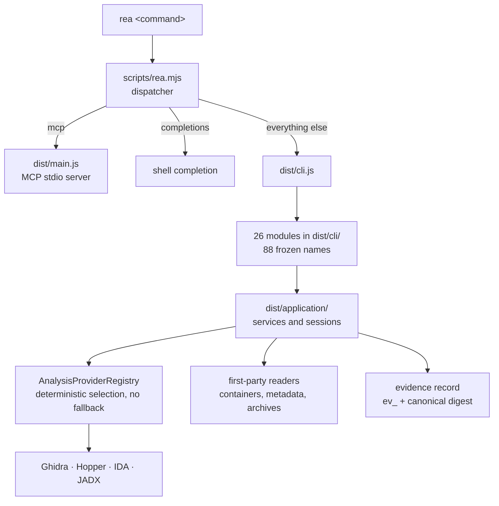

A universal Mach-O is a file with several architectures concatenated, and I pointed the tool at one anyway. It refused, which took under a second, and the refusal was the best thing it produced all day:

```text
status: "unsupported"
code: "architecture_unsupported"
reason: "Ghidra v1 cannot enforce the selected architecture when importing a
universal Mach-O; analyze a thinned Mach-O slice instead."
```

Nothing was analysed, no partial answer was offered, and the sentence tells you the boundary is the provider's rather than the file's. One `lipo -thin` later [7] the same analysis runs. I have used enough tools that answer a slightly different question to want to look at how this one is built, and that is what this post is. The tool is MIT-licensed and published to npm as `rea-agents` [1].

Everything below is measured against **5.0.0**, the build installed on this machine. Upstream published 6.5.0 the day before this post was written, so treat the numbers as a snapshot of a moving target rather than as documentation.

> **The Core Takeaway:** the evidence id hashes what a record means rather than where the file sat on your disk, which is why two machines can compare results at all. The ceilings are equally explicit: twelve named refusals, documented byte limits per format, and Node's default heap, which a 3 MB bundle exhausted.

## One dispatcher, then a file per area of work

The entry point is a small script whose entire job is routing. Three arguments mean three destinations: `mcp` starts the stdio server, `completions` answers with a shell completion script, and everything else is handed to the CLI adapter. That is why the help lists two commands the command inventory does not contain.



The names live in one frozen object, and the files under `dist/cli/` are organised by area of work rather than by platform: one for Android, one for firmware, several for the browser and page-execution surfaces, one for managed code. Adding a capability adds a file. There is no central switch statement to edit, which is the difference between a tool that grows and one that acquires conflicts. The project draws its own layer diagram, which is the fastest way to check any of this against a later release [6].

I care about this shape for a dull reason. A command surface of 88 names is too large to hold in your head, and the only thing that makes it navigable is that the names are predictable, so `inspect-` and `trace-` and `compare-` mean the same thing wherever they appear.

## An id that survives your filesystem

Every result returns an id of the form `ev_` followed by 64 hex characters. It is not a random handle or a counter. It is a digest computed over a projection of the record, and the projection is the interesting part:

```js
/** Recompute the semantic identifier, excluding paths and raw payload bytes. */
const computeEvidenceId = (evidence) =>
  `ev_${digestCanonicalValue(semanticProjection(evidence), "Evidence")}`;
```

Two things are deliberately outside the hash: the subject's file name and its absolute path on the machine. The reasoning is stated in the source and it is the right reasoning. Where a file sits is not part of what a result means, so a Mac and a Linux box analysing identical bytes should produce the same id, and a result can be compared between machines without normalising paths first.

Everything that does bear on meaning goes in: the target's own digest, its format and architecture, the producing provider and its version, the analysis profile, the operation and its parameters, both raw and normalised results, the confidence and authority values, the environment, the limitations, and the locations the result anchors to. The digest is computed over canonical JSON [3], which is what makes key order and number formatting irrelevant, and it is why the same record serialised twice produces the same id rather than two.



The id is then re-derived whenever a record is parsed, and a mismatch throws. That is a stronger position than it sounds. An evidence bundle is ordinary JSON that anyone can edit, and this design turns a silent edit into a load failure, so a bundle either is what it claims or does not open.



## The unknowns are a first-class record

Most tooling records what it found. This one also records what it could not establish, as a structure with a status, a severity, a disposition, and a chain of revisions. The statuses are worth reading in full because they encode an epistemic position rather than a progress bar:

| Status | Meaning |
| :--- | :--- |
| `open` | Not established yet |
| `investigating` | Being pursued |
| `blocked` | Cannot be pursued with the current provider |
| `contradicted` | Someone else's evidence disagrees, and the contradiction is stored |
| `resolved` | Settled, and the resolution must be attached |

Two invariants hold it together. A record cannot be `resolved` without a resolution attached, and it cannot be `contradicted` without naming the evidence that contradicts it. Reconstruction coverage is then evaluated against the ledger, and coverage fails closed: if an obligation depends on an open or contradicted unknown, the result is not complete, whatever the rest of the record says.

That is the mechanism behind the opening anecdote. A zero is not a measurement of the world until the coverage question has been asked, and here the tool asks it in its own output rather than leaving it to whoever reads the summary.

## Who does the parsing

The split between what REA parses itself and what it delegates is the part that determines what you can run offline.

| Artifact | Who parses it |
| :--- | :--- |
| Managed PE and CLI metadata | Its own readers: 17 modules under `dist/dotnet`, and none of them starts a subprocess. PE headers, metadata heaps and method bodies are decoded in JavaScript |
| Apple keyed archives and interface-builder documents | Its own decoders, with byte ceilings of 64 MiB per document and one million records for a nib archive |
| Apple asset catalogs | Delegated: the compiled catalog is read by the platform's own `assetutil` |
| Native binaries | Delegated to Ghidra, Hopper or IDA, chosen by a registry that will not substitute one for another |
| Android, firmware | Delegated to a JADX bridge, and to binwalk or unblob on Linux |
| Owned Electron and browser scenarios | Runtime observation, bounded to a scenario you launch yourself |

The managed row is the one I did not expect. A .NET assembly can be inspected without .NET installed, because the metadata tables are just a format, and the format is a published standard [4]. Treating them as data rather than as a runtime is what makes that possible.



## Where it stops

Refusals are code, not advice: twelve named conditions in the installed build, among them `architecture_unsupported` for the fat binary above and `target_role_unsupported` for a file the tool cannot classify, which is the code that produced the misleading zero. A missing provider is `not_configured` or `executable_missing` rather than a quiet downgrade. Upstream publishes its error contract separately, and it is the better source for what the current release returns [5].



Then there are explicit ceilings, all of them bytes or counts rather than timeouts:

| Ceiling | Value |
| :--- | :--- |
| Apple catalog and keyed archive | 64 MiB per document |
| Nib archive records | 1,000,000 |
| Provider refusals | 12 named codes |

And the ceiling that is not in the table, because it belongs to the runtime rather than to the tool. I asked it to analyse a 3 MB minified JavaScript bundle, and it died after 638 seconds with exit 134 and an empty output file:

```text
FATAL ERROR: Ineffective mark-compacts near heap limit
JavaScript heap out of memory
```

That message arrives at 3.8 to 4.0 GB, which is Node's default old-space ceiling [2]. The tool had no opinion about it and neither did the file, which is 3 MB: what exhausted the heap was the graph the analysis was building, not the input. Narrowing the artifact is the fix that costs nothing. A tree holding `package.json`, the preload and the splash assets analysed in seconds, exited 0 and produced a 47 KB graph, and the question I actually had was answered by that run.

There is one more environment fact in the same family, and it is worth knowing before you trust a health check. `rea doctor` judges the shell it runs in rather than the installation. Run it from a shell whose `PATH` resolves an older Node and it reports the dependency missing and the environment unhealthy, while the tool itself starts and answers every question. A health check that reports on your shell is not wrong. It is answering a different question than the one you asked.

The lesson generalises past this tool. An out-of-memory death is the instrument telling you the question was too broad, and the response is to narrow the question rather than to buy more memory. Raising the heap with `--max-old-space-size` is available and legitimate [2], but it is a decision to analyse more of the artifact than you need.

## The part worth taking

I keep coming back to the same two ideas. First, an identifier derived from the meaning of a record rather than from where you happened to store it. Second, an explicit record of what was not established, with contradictions stored next to the claims they contradict, and a coverage check that fails closed rather than reporting success over a hole.

You can adopt both without adopting the tool, and both are more valuable than any single parser inside it. The next time a tool tells you zero, the question to ask is the one this design answers in print: zero out of how much.

## References

[1] [morluto/rea](https://github.com/morluto/rea): the project this post measures, MIT, npm package `rea-agents`. Every number here comes from the locally installed 5.0.0 build.

[2] [Command-line API](https://nodejs.org/api/cli.html): the Node.js flags documentation, including `--max-old-space-size`, which is the flag that moves the ceiling described above.

[3] [RFC 8785, JSON Canonicalization Scheme](https://www.rfc-editor.org/rfc/rfc8785): the canonicalisation any deterministic digest over JSON depends on. Two implementations that disagree about key order or number form will compute different hashes for the same object.

[4] [ECMA-335](https://ecma-international.org/publications-and-standards/standards/ecma-335/): the Common Language Infrastructure standard that defines the PE metadata tables and heaps the managed reader decodes without a runtime.

[5] [error-contract.schema.json](https://github.com/morluto/rea/blob/main/docs/error-contract.schema.json): the published error contract, which is a better source than a review for the current set of failure codes.

[6] [architecture.mermaid](https://github.com/morluto/rea/blob/main/docs/architecture.mermaid): the project's own layer diagram, useful for placing the dispatched CLI, the registry and the provider adapters relative to each other.

[7] [lipo(1)](https://keith.github.io/xcode-man-pages/lipo.1.html): `lipo -thin`, the command that turns a universal Mach-O into the single-architecture slice the provider accepts.
